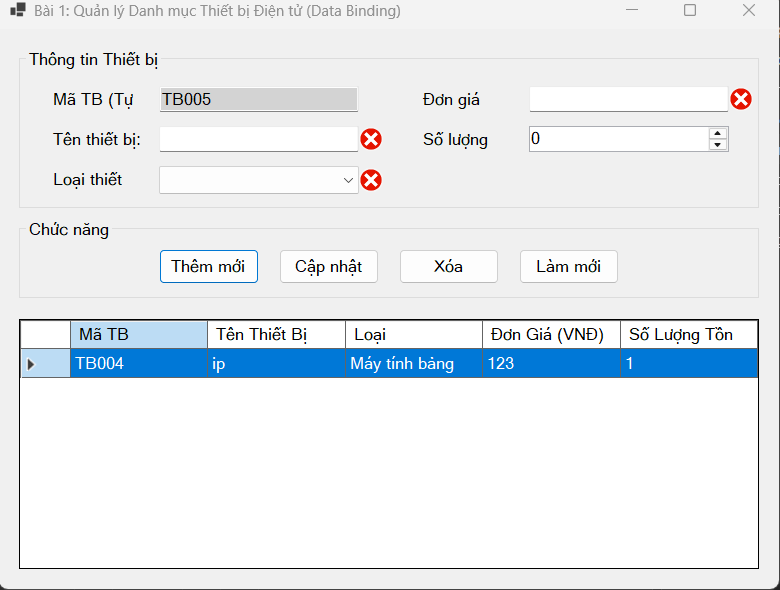
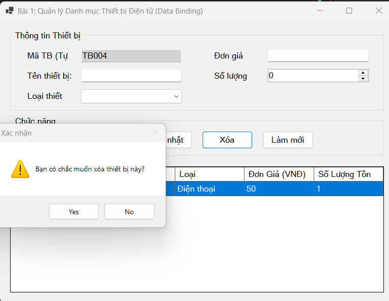

## Thông tin sinh viên
- **Họ và tên:** Nguyễn Trường Giang
- **Mã số sinh viên:** 24810310200
- **Lớp:** D19CNPM3
- **Tên môn học:** Lập trình .NET
- **Nội dung:** Bài kiểm tra số 2

---

## KẾT QUẢ THỰC HIỆN

### BÀI 1: QUẢN LÝ THIẾT BỊ ĐIỆN TỬ (DATA BINDING)
**1. Giao diện & Hiển thị DataGridView**

**2. Test bắt lỗi nhập liệu (ErrorProvider)**

---

### BÀI 2: QUẢN LÝ KHO & XUẤT BÁO CÁO (SYSTEM DIALOGS)
**1. Đọc/Ghi file CSV & Chọn ảnh sản phẩm**

**2. Xác nhận hệ thống & ToolStrip/StatusStrip**

---

### BÀI 3: HỆ THỐNG MDI QUẢN LÝ SIÊU THỊ (ASYNC/AWAIT)
**1. Giao diện MDI Cha - Con**

**2. Xử lý tải dữ liệu bất đồng bộ (ProgressBar)**

